# PVX — extended symbol library for AVEVA PI Vision

[](https://github.com/willcgage/AVEVAPIVisionSymbols/actions/workflows/ci.yml)
[](LICENSE)

Thirty-three production-ready custom symbols that fill the gaps in PI Vision's stock
palette: analytics charts, KPI and status panels, navigation controls, Event
Frame analysis and manual data entry. Plus the build, preview and
verification tooling to keep adding more.

Twenty-eight of them run entirely on PI Vision's own data pipeline — no PI Web
API, no server-side prerequisites beyond copying a folder. Five reach further
(Event Frames, the AF hierarchy, writing values back) and need PI Web API; see
**[docs/PI-WEB-API.md](docs/PI-WEB-API.md)**.

Works with PI Vision 2019 through 2025 — the symbol extensibility model
(`Scripts\app\editor\symbols\ext`, AngularJS 1.x, `PV.symbolCatalog.register`)
has been stable across that whole range, and every symbol here is written to it
in ES5 with no third-party libraries.

---

## The symbols

### Charts and analytics

| | Symbol | What it's for |
|---|---|---|
| 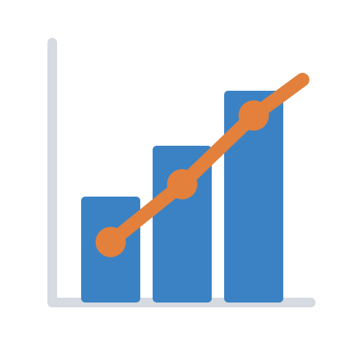 | **PVX Combo Chart** | Bars, lines, areas, steps and scatter on one time axis with an independent right-hand scale and shaded limit bands. The native trend draws every trace the same way; this does not. |
| 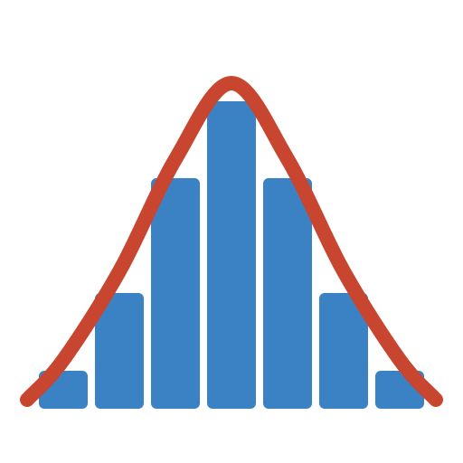 | **PVX Distribution** | Frequency histogram with a fitted normal curve, spec limits, and **Cp / Cpk / expected ppm**. A capability study, not just a chart. |
| 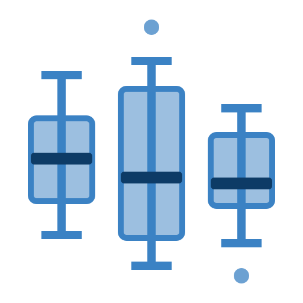 | **PVX Variability** | Quartiles, whiskers and outliers, one box per tag. Twenty identical assets side by side — the wide box is the one to go and look at. |
| 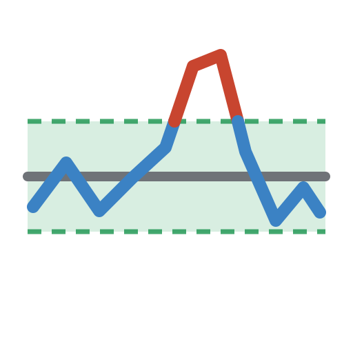 | **PVX Deviation from Target** | Deviation from setpoint with the tolerance band shaded, excursions coloured by direction, and time-in-band, excursion count and longest excursion computed from real sample intervals. |
| 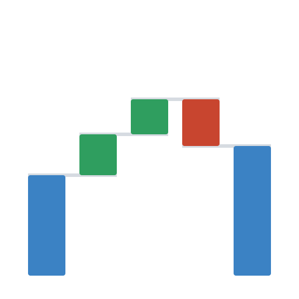 | **PVX Waterfall** | Floating bars bridging a start value to an end value through signed steps, with connectors and running subtotals. Mass and energy balances, yield-loss accounting. |
|  | **PVX Period Comparison** | Folds the window into N periods overlaid on a common relative-time axis, with a min/max envelope from the older ones. Today over yesterday over the golden batch. |
| 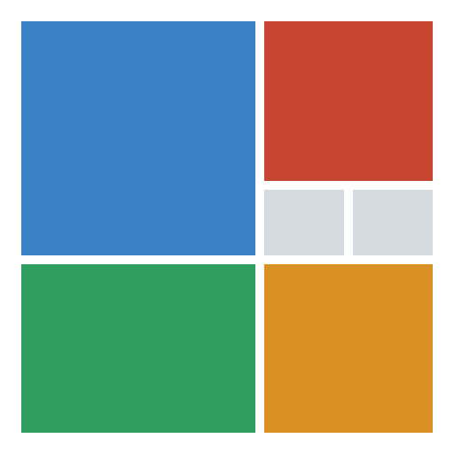 | **PVX Treemap** | Squarified rectangles sized by one statistic and coloured by another. Size shows who is big, colour shows who is in trouble; the tile that is both is the one to look at. |
|  | **PVX Flow** | Weighted ribbons between nodes with per-node balance checking — where inflow and outflow disagree, you have a leak, a bad meter or a missing tag. |
| 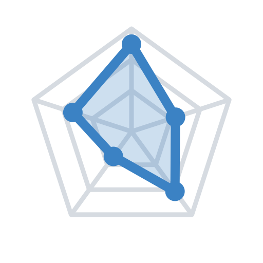 | **PVX Fingerprint** | Normalised multi-axis polygon over a reference profile. Shape recognition: does this asset still look like it used to. |
| 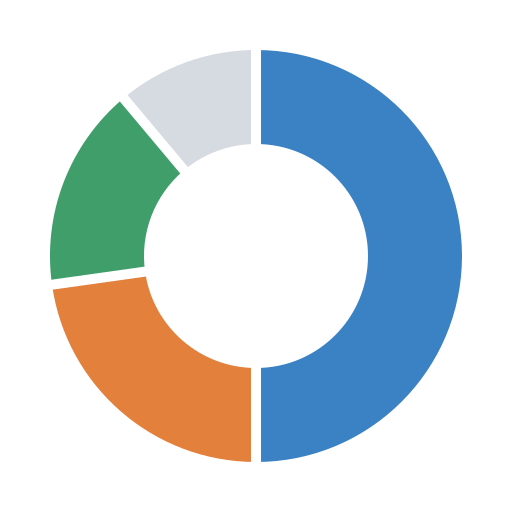 | **PVX Contribution** | Share of a total with the total in the hole. The config pane is honest that a ranked bar reads better for magnitude. |
| 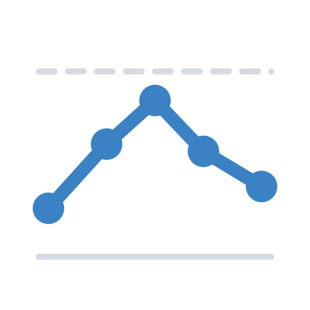 | **PVX Spatial Profile** | Values along a *physical* axis — kiln zones, column trays, cell voltages — with a limit envelope and a faded "shadow" profile so drift shows as a change of shape. |
| 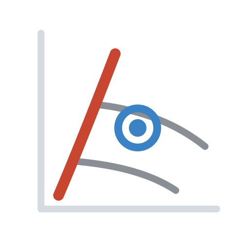 | **PVX Operating Map** | The live operating point on a compressor or pump map: surge line, control line, speed lines and stonewall, a fading trail showing direction of travel, and surge margin as a number. The curves can live on the AF element, so the map follows asset swapping. |
| 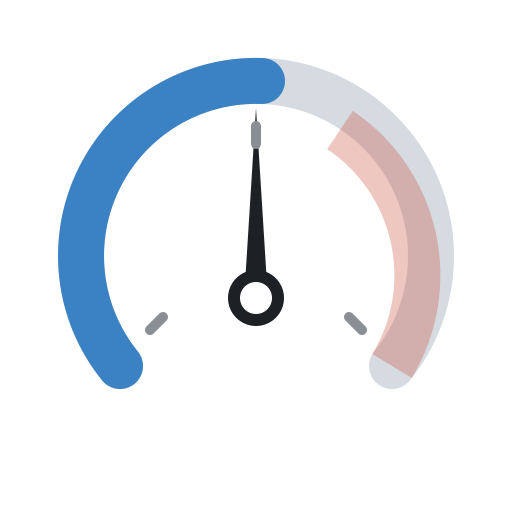 | **PVX Radial Gauge** | Threshold-banded dial. Configurable sweep from a shallow arc to a full ring, needle or progress arc, target marker. |
| 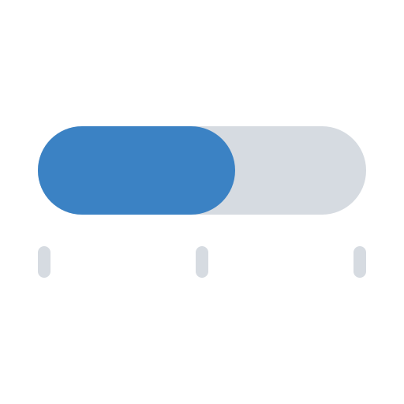 | **PVX Bar Indicator** | Horizontal or vertical level bar. Solid, gradient or segmented; threshold bands on the track; target marker. |
| 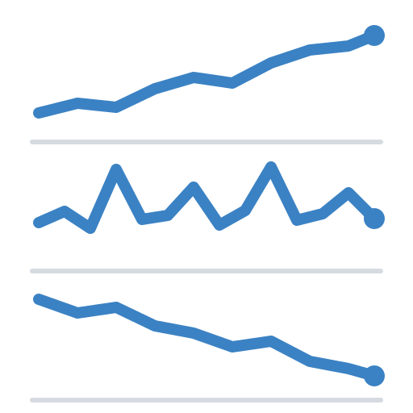 | **PVX Multi Sparkline** | One dense row per tag — name, micro-trend, current value. Twenty tags at a glance, which the stock trend cannot do. |
| 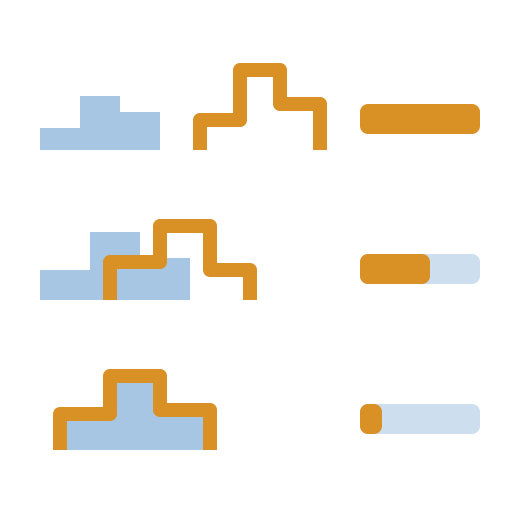 | **PVX Condition Compare** | Splits the time range by a rule on one tag ("yield < 92%") and ranks every other tag by how differently it behaves while the rule holds, with paired histograms per tag. What is different about the bad hours, without the trip to Excel. |
| 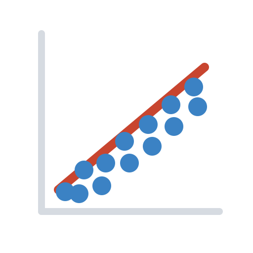 | **PVX XY Scatter** | Correlation of one tag against another with least-squares regression, R², time-coloured points and an operating-envelope box. |
| 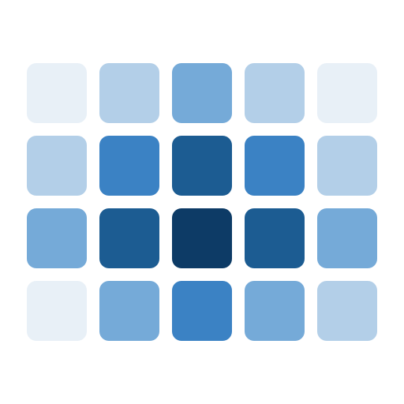 | **PVX Heatmap** | Hour-of-day × day calendar, tag × time-bucket matrix, or value × time density weighted by time spent. Makes diurnal and shift patterns obvious, and shows a hunting valve as two bands where a trend shows a smear. |
| 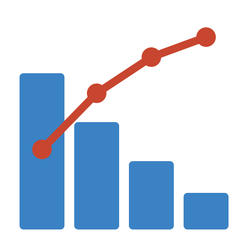 | **PVX Ranked Bar** | Sorted bars with an optional cumulative Pareto line. "Which five assets drive 80% of the loss." |

### KPI and status

| | Symbol | What it's for |
|---|---|---|
|  | **PVX Annunciator** | Latching alarm tiles with the ISA-18.2 ringback state, so an excursion that starts and clears between two refreshes is still there when someone looks. First-out marking for cascades. |
| 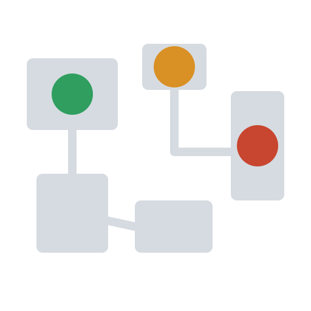 | **PVX Site Plan** | Live values pinned to a plant drawing by percentage coordinates. The offline answer to a map symbol — no tile provider required. |
| 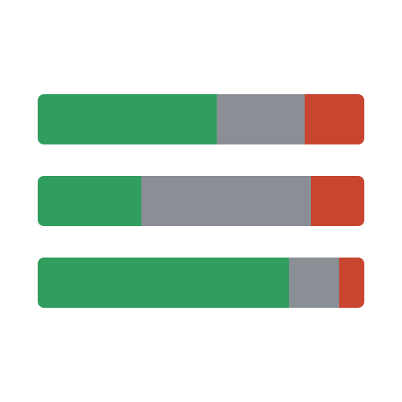 | **PVX Time in State** | Time-in-state timeline or stacked bar per digital tag, with uptime percentage and transition count. Downtime accounting with no Event Frames, no AF templates and no PI Web API. |
| 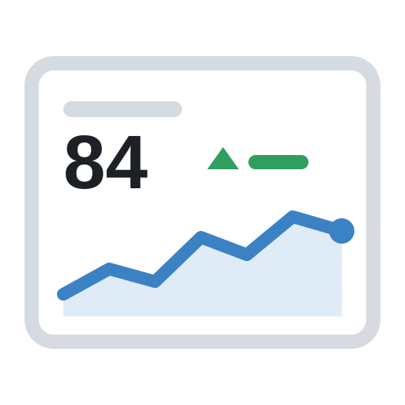 | **PVX KPI Card** | Headline number, period-over-period delta with a good/bad direction, inline sparkline, footer statistics. |
| 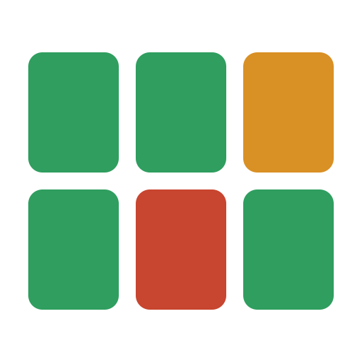 | **PVX Status Grid** | Responsive tile grid coloured by thresholds or by a digital state map. Four tile styles, optional drill-down. |
| 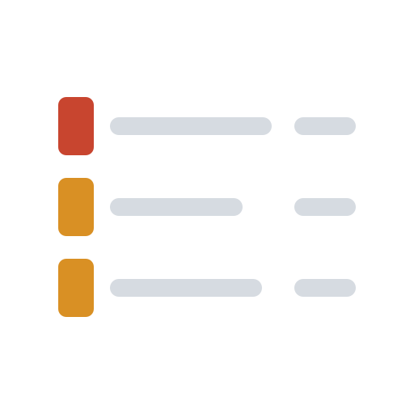 | **PVX Exception Banner** | Shows only the tags currently outside limits, worst first, with dwell time. List, ticker or summary mode. |
| 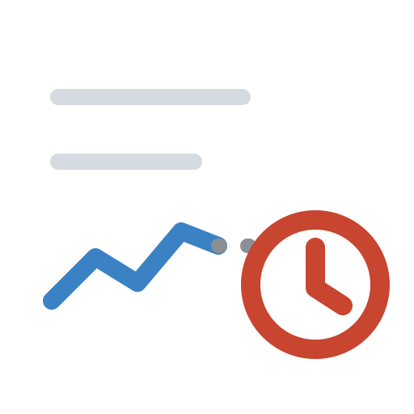 | **PVX Data Health** | Lists only the tags that can't be trusted right now: bad, out of instrument range, stale, or flatlined. The healthy rest are a count in the footer, so nothing is silently dropped. |

### Event Frames, AF and data entry · needs PI Web API

| | Symbol | What it's for |
|---|---|---|
| 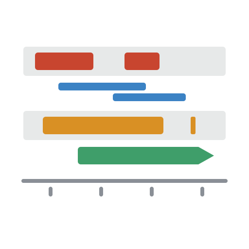 | **PVX Event Timeline** | Event Frames as swimlanes per asset, stacked where they overlap, with open events drawn to the edge rather than faked as finished. The native Events Table is a list; this shows pattern and clustering. A hierarchy mode nests child frames under their parents (batch, unit procedure, phase) and flags the steps that ran longer than typical. |
| 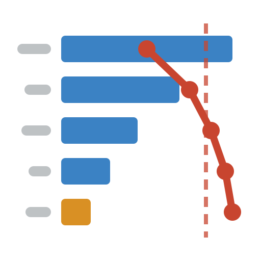 | **PVX Event Analytics** | Which reason code costs the most hours. Durations are clipped to the window and overlapping events merged before summing — and the footer says when merging changed the total, because a downtime figure that double-counts ends up in a report. |
| 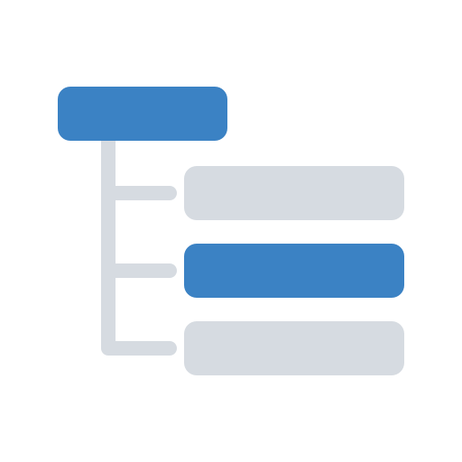 | **PVX Asset Navigator** | Browses the live AF hierarchy and sets the display's asset context, so a unit added in AF appears without editing a display. Lazy-loaded, keyboard navigable. |
| 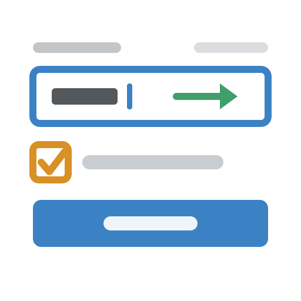 | **PVX Manual Entry** | Writes one value to an attribute or PI point, with range validation before sending and a confirm step before committing. |
| 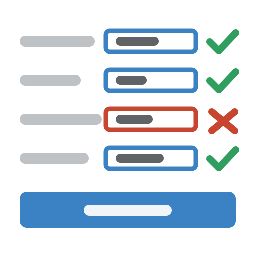 | **PVX Shift Log** | The same at operator-rounds scale: several attributes, one form, one submit — reporting per row, so three saved and one refused reads as exactly that. |

### Navigation

| | Symbol | What it's for |
|---|---|---|
| 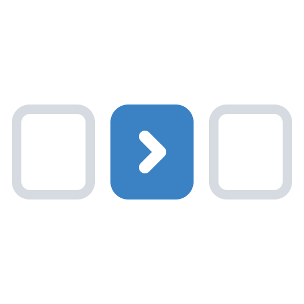 | **PVX Navigation Panel** | Button bar that jumps between displays, swaps the asset context, or sets the time range. |
|  | **PVX Display Slideshow** | Rotates a control-room screen through a list of displays. The same config goes on every display in the rotation and each copy works out where it is — pause survives the navigation, and it never rotates while someone is editing the display. |

Full option reference: **[docs/SYMBOL-REFERENCE.md](docs/SYMBOL-REFERENCE.md)** (generated from the code).

---

## Quick start

Grab the latest [release](https://github.com/willcgage/AVEVAPIVisionSymbols/releases)
— `PvxSymbols-<version>.msi` if you deploy software with an installer, or
`pvx-symbols-<version>.zip` if you copy files. Check it against
`SHA256SUMS.txt`, then on each PI Vision web server, elevated:

```powershell
msiexec /i PvxSymbols-1.8.0.msi /qn /l*v pvx-install.log
```

Or build it yourself:

```bash
npm install          # only needed for the preview/verify tooling
npm run package      # builds dist/ext and zips it
npm run installer    # additionally generates the WiX installer source
```

Install the MSI on the PI Vision server, or copy `dist/ext` there with the
generated `dist/Deploy-PvxSymbols.ps1`, then recycle the app pool and
hard-refresh the browser. Both use the layout AVEVA's extensibility guide
describes: symbol files directly in `ext`, icons in `ext\icons`, and the shared
runtime and site settings in `ext\libraries\pvx`. Both take the
drive and PIPC folder PI Vision is installed in (`INSTALLDRIVE` / `PIPCFOLDER`,
or `-Drive` / `-PIPCFolder`), defaulting to `PIHOME64`. The PVX symbols appear at the bottom of the symbol palette in display
edit mode; pick one and drag an attribute onto the display to place it (any
attribute for the seven that take their settings from the format pane alone). That is the whole installation for twenty-eight of the thirty-three.

Dropped the wrong attribute on a symbol? Open its format pane: every PVX
symbol lists its data sources at the top, with **Remove** on each row (click
Remove, then Confirm). Settings that refer to sources by number, such as a
Combo Chart trace spec or a Sankey link, are renumbered to match and the pane
says what changed. A symbol always keeps at least one source.

The other five need one more step: run `ext/piwebapi-check.html` on the server
to find out which PI Web API configuration your network actually permits, then
put the answer in `ext/libraries/pvx/pvx-config.js`.

Full walkthrough — install, confirm, configure, upgrade, roll back, troubleshoot:
**[docs/DEPLOYMENT.md](docs/DEPLOYMENT.md)**.

### Preview without a server

```bash
npm run preview      # http://localhost:8777
```

Opens an offline harness that loads the *built* symbols, feeds them synthetic
plant data, and lets you resize each one, toggle dark mode, open its real
configuration pane, and simulate empty and bad-quality payloads. Nothing here
talks to PI Vision — it is a faithful stand-in for the host, so it is the
fastest way to iterate before touching the server.

---

## Repository layout

```
src/
  shared/
    pvx-core.js        shared runtime -> ext/libraries/pvx/pvx-core.js
    pvx-config.js      site settings template -> ext/libraries/pvx/pvx-config.js
    base.css           base styles, prepended to every symbol stylesheet
  symbols/<typeName>/
    symbol.js  template.html  config.html  styles.css  icon.svg
  tools/
    Deploy-PvxSymbols.ps1   the manual-copy deploy script (copied to dist/)
    piwebapi-check.html     the PI Web API diagnostic -> ext/
tools/
  build.js             src -> dist/ext, with validation
  verify.js            renders every symbol in headless Chromium and checks it
  docgen.js            regenerates docs/SYMBOL-REFERENCE.md from the sources
  serve.js             static server for the preview harness
  probe.js             render one symbol from src/ at any size — the inner loop
dev/
  harness.html         offline preview app
  pv-mock.js           PI Vision host stub + synthetic data generator
dist/                  build output — this is what you deploy
docs/                  reference, deployment, authoring guide, roadmap
```

### npm scripts

| Command | Does |
|---|---|
| `npm run build` | Builds `dist/ext` and validates every symbol |
| `npm run package` | Clean build plus `dist/pvx-symbols-<version>.zip` |
| `npm run watch` | Rebuilds on save |
| `npm run preview` | Serves the offline harness |
| `npm run verify` | Builds, then renders all symbols in headless Chromium |
| `npm run verify:shots` | Same, plus PNGs in `dist/screenshots/` |
| `node tools/probe.js <symbol>` | Render one symbol from `src/` at any size with any config override, and screenshot it — the inner development loop |
| `npm run test:api` | Exercises the PI Web API layer against a mock that is deliberately misconfigured — no CORS, wildcard CORS, a 401 preflight — and asserts each is diagnosed correctly, plus that writes are never cached, retried or coalesced |
| `node tools/docgen.js` | Regenerate `docs/SYMBOL-REFERENCE.md` from the sources |
| `node tools/wix.js` | Generate the WiX installer source from `dist/ext`, with deterministic component GUIDs |
| `node tools/verify-msi.js` | Read a built MSI's own tables and assert it installs what it claims |
| `tools/test-installer.ps1` | On Windows, elevated: install, upgrade from 1.6.0 and uninstall the MSI and the deploy script for real against fake PI Vision trees — CI runs it on every pull request |

---

## How it holds together

**One shared runtime.** `pvx-core.js` deploys to `ext/libraries/pvx`, inside
the folder PI Vision loads before the symbol files. It carries the formatting,
colour, threshold, scale, SVG, data-normalisation, statistics and navigation
helpers, so a symbol file contains only what makes that symbol different.

**One lifecycle.** `PVX.bootstrap()` wires `onDataUpdate` / `onConfigChange` /
`onResize` / `onDestroy` to a single render function, coalesced into one
animation frame. A symbol never renders three times for one update, and never
paints into a stale DOM node.

**One threshold grammar.** `0:#2f9e5f:Normal, 70:#d99024:High, 90:#c8452f:Critical`
means the same thing in every symbol, so an engineering standard can be pasted
across a whole display set. Digital state maps and combo-chart trace specs use
the same shape of string, for the same reason.

**One statistics implementation.** Quartiles, histogram binning (Freedman-
Diaconis), capability indices and the normal CDF live in `PVX.stats`, so the
histogram and the box plot cannot disagree about what a quartile is.

**One statistic-column contract.** PI Vision returns `Summary` cells
*positionally*, matching `config.Columns` — if the operator's chosen aggregate
and that array drift apart, a symbol silently charts the wrong number with no
error. `PVX.config.syncStatColumns()` is the single place that can be wrong,
and the seven Table-shape symbols all go through it.

**Nothing is dropped silently.** Negative values in a treemap, a donut or a
Sankey cannot be drawn as an area or a ribbon. Every symbol that excludes a
source names it in the footer — a display that quietly omits a tag is worse
than one that refuses to draw.

**Authentication is a property of the deployment, not of a chart.** `PVX.api`
holds one PI Web API client with swappable auth — Kerberos, OIDC bearer, Basic
— configured once per site in `ext/libraries/pvx/pvx-config.js`. No symbol knows which
is in use, so changing it later touches one file. Failures carry a specific
cause and a "what to check" line rather than "failed to fetch".

**Writes are treated as irreversible, because they are.** `PVX.api` never
caches, retries or batches a write. Symbols confirm with a human first, validate
before sending rather than after, disable the control while a write is in
flight, and report every row's outcome separately — a shift log where three rows
saved and one was refused shows exactly that.

**Light and dark, automatically.** Symbols sample the rendered background of
their ancestors rather than sniffing PI Vision's theme class names, which move
between releases. Set `Theme` to force one or the other.

**PI Vision's data shapes, normalised.** `PVX.data.single/series/rows/trend`
absorb the payload differences between releases so symbol code only ever deals
with one predictable structure.

### Verification

`npm run verify` renders each symbol in real Chromium across 3 sizes × 3 data
scenarios (live, empty, bad-quality) × light and dark — 594 checks — and fails
on thrown exceptions, console errors, `NaN`/`undefined` in SVG geometry, blank
renders, unreadable text, and content clipped out of reach. That is the gate to
run before any deployment.

### Adding a symbol

Read **[docs/AUTHORING-CONTRACT.md](docs/AUTHORING-CONTRACT.md)**, copy
`src/symbols/pvxRadialGauge` (the reference implementation), rename it, and
build. The build validator enforces the contract — ES5 only, namespaced CSS,
correct registration, matching `typeName`.

Iterate with the probe rather than the full verify:

```bash
node tools/probe.js pvxHistogram --w 900 --h 480 --config "LSL=100;USL=140"
node tools/probe.js pvxComboChart --dark --config "TraceSpec=1:bar,2:line:right"
node tools/probe.js pvxSlideshow --hash "/Displays/101/Overview"
```

It renders straight from `src/`, so there is no build round-trip, and it picks
its own port — several can run at once.

Where the plan landed: **[docs/ROADMAP.md](docs/ROADMAP.md)**, or **[docs/roadmap.html](docs/roadmap.html)** for a filterable view — 30 roadmap symbols shipped, 3 foundation pieces, and 4 candidates that were declined with the reason on each. `pvxCompare`, `pvxOperatingMap` and `pvxDataHealth` came afterwards, from a gap analysis and a comparison with Grafana and Honeycomb.

---

## Licence and third-party code

MIT. No third-party JavaScript is bundled or required at runtime. AngularJS is
vendored under `dev/vendor/` for the offline preview harness only and is never
deployed to the server.

A PI Vision licence does not grant rights to the third-party libraries PI
Vision itself ships — notably Kendo UI. Nothing here uses them.
